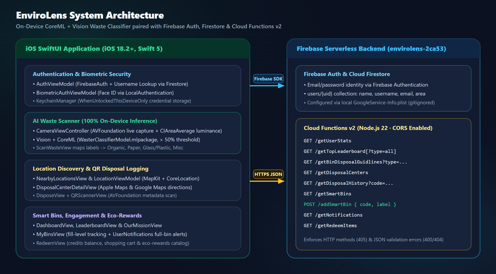
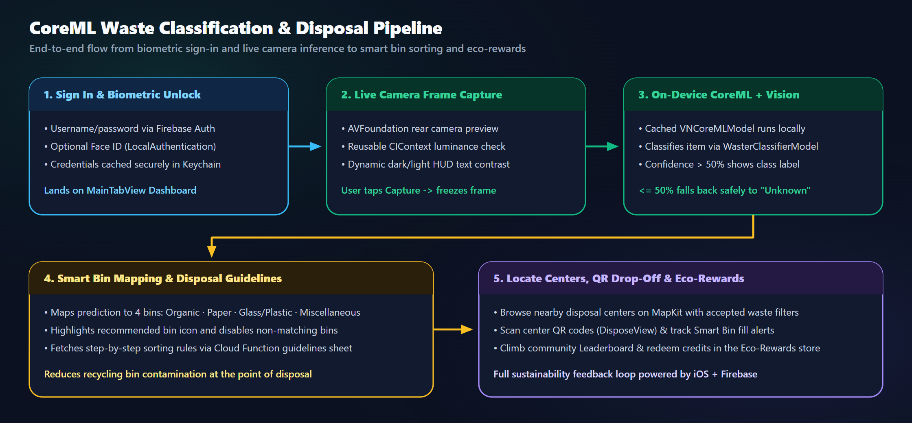

# EnviroLens

An AI-powered iOS waste-classification and recycling companion built with **SwiftUI**, **CoreML**, **Vision**, **MapKit**, and **Firebase**—helping users identify waste in real time, locate nearby disposal centers, monitor smart bins, and earn eco-rewards.

[](LICENSE)


---

## Overview

**EnviroLens** turns your iPhone camera into an on-device waste sorting assistant. Point the camera at an item to classify it locally with **CoreML** and **Vision**, automatically highlight the matching disposal bin category (`Organic`, `Paper`, `Glass/Plastic`, or `Miscellaneous`), view step-by-step disposal guidelines, locate nearby recycling centers on **MapKit**, scan QR codes at smart bins or drop-off centers, and redeem accumulated credits for eco-friendly rewards.

### Key Features

- **On-Device AI Waste Classification:** Uses `AVFoundation`, `Vision`, and `WasterClassifierModel.mlpackage` with a `50%` confidence threshold and dynamic camera luminance detection (`CIAreaAverage`) for readable HUD contrast.
- **Biometric & Keychain Authentication:** Supports Firebase Auth username/email login paired with **Face ID** (`LocalAuthentication`) and `WhenUnlockedThisDeviceOnly` iOS Keychain credential persistence.
- **Interactive Disposal Centers Map:** Displays local waste & recycling facilities on **MapKit** with `CoreLocation` distance calculation, accepted waste tags, operating hours, and Apple Maps / Google Maps turn-by-turn directions.
- **Smart Bin Monitoring & Alerts:** Scans QR codes to register new smart bin groups, tracks fill levels per bin category, and schedules local `UserNotifications` reminders when bins reach capacity.
- **Gamified Eco-Impact & Rewards:** Tracks personal waste credits and disposal history (`DisposeView`), displays community rankings (`LeaderboardView`), and includes an interactive cart & checkout flow (`RedeemView`).
- **Serverless Firebase Functions v2 Backend:** Node.js 22 HTTP API endpoints with CORS enabled, strict HTTP method validation, and structured JSON error handling.

---

## System Architecture & Pipeline

### System Architecture



### Classification & User Pipeline



---

## How to Run Locally

### Prerequisites

- **macOS** with **Xcode 16+** (deployment target `iOS 18.2+`, Swift 5)
- **Apple Developer account** (for physical device camera & Face ID testing)
- **Firebase project** with Authentication (Email/Password) and Cloud Firestore enabled
- **Node.js 22+** and Firebase CLI (`npm install -g firebase-tools`) for local backend emulation or deployment

### 1. Configure & Run the iOS App

1. Clone the repository:
   ```bash
   git clone https://github.com/Ockersz/EnviroLens.git
   cd EnviroLens
   ```
2. Add your Firebase configuration file (the live file is intentionally gitignored for security):
   ```bash
   cp EnviroLens/EnviroLens/GoogleService-Info.plist.example EnviroLens/EnviroLens/GoogleService-Info.plist
   ```
   Replace the placeholder values in `EnviroLens/EnviroLens/GoogleService-Info.plist` with your own `GoogleService-Info.plist` downloaded from **Firebase Console &rarr; Project Settings &rarr; Your iOS App**.
3. Open `EnviroLens/EnviroLens.xcodeproj` in **Xcode**.
4. Wait for **Swift Package Manager** to resolve packages (`Package.resolved` is included).
5. Select your Development Team under **EnviroLens target &rarr; Signing & Capabilities** and adjust the Bundle Identifier if needed.
6. Ensure `EnviroLens/EnviroLens/MLModels/WasterClassifierModel.mlpackage` is included in the target membership.
7. Run on an **iOS Simulator** (for UI flows, auth, MapKit, and API views) or a **physical iPhone** (required for live rear-camera classification, QR scanning, and Face ID).

### 2. Run or Deploy Firebase Functions

```bash
cd backend/functions
npm install

# Run locally with Firebase Emulators
npm run serve

# Or deploy to your Firebase project (update backend/.firebaserc first)
npm run deploy
```

> [!NOTE]
> The iOS views currently call the hosted `envirolens-2ca53` Cloud Functions URLs by default. Update those endpoint URLs in the Swift views if you deploy to your own Firebase project or test against the local emulator.

### 3. Running Unit & UI Tests

Unit tests (`EnviroLensTests`) and UI tests (`EnviroLensUITests`, `EnviroLensUITestsNew`) are configured in the Xcode workspace.

Before running login-dependent UI tests, add test account credentials to your Xcode Test Scheme (**Product &rarr; Scheme &rarr; Edit Scheme &rarr; Test &rarr; Arguments &rarr; Environment Variables**):

| Environment Variable | Description | Default Fallback |
| :--- | :--- | :--- |
| `ENVIROLENS_TEST_USERNAME` | Username of a test account in Firebase/Firestore | `demo_user` |
| `ENVIROLENS_TEST_PASSWORD` | Password for the test account | `DemoPass@123` |

---

## Backend API Reference

All endpoints are exported from [`backend/functions/index.js`](backend/functions/index.js) as CORS-enabled Firebase Cloud Functions v2 HTTP handlers:

| Endpoint | Method | Query / Body Params | Description |
| :--- | :---: | :--- | :--- |
| `/getUserStats` | `GET` | — | Returns user eco-credits (`credits`) and `areaRank` |
| `/getTopLeaderboard` | `GET` | `?type=all` *(optional)* | Returns top 3 leaders by default, or top 10 when `type=all` |
| `/getBinDisposalGuidlines` | `GET` | `?type=<category>` *(required)* | Returns sorting guidelines for `organic`, `paper`, `glass_plastic`, or `miscellaneous` |
| `/getDisposalCenters` | `GET` | — | Returns disposal center coordinates, accepted waste types, and operating hours |
| `/getDisposalHistory` | `GET` | `?code=<qr>` | Returns dated waste disposal weights by category |
| `/getSmartBins` | `GET` | — | Returns smart bin locations and per-category fill levels |
| `/addSmartBin` | `POST` | JSON `{ "code": "...", "label": "..." }` | Registers a new smart bin location group and returns updated bins |
| `/getNotifications` | `GET` | — | Returns recent bin alerts and reward notifications |
| `/getRedeemItems` | `GET` | — | Returns categorized eco-reward items and credit prices |

---

## Why This Was Built

Recycling contamination often happens right at the bin because people aren't sure whether an item belongs in organic, paper, plastic/glass, or general waste. **EnviroLens** was built to bridge **on-device computer vision** with **actionable recycling guidance and gamification**:

- **Zero-latency, privacy-preserving inference:** Running `WasterClassifierModel` locally with Apple's **CoreML** and **Vision** frameworks avoids uploading camera frames to external servers.
- **Full-stack portfolio architecture:** Pairs a modular **SwiftUI + MVVM** iOS application (camera capture, Keychain, Face ID, MapKit, CoreData, XCTest/XCUITest) with a clean **Firebase Auth / Firestore / Cloud Functions v2** backend.

---

## Project Structure

```text
EnviroLens/
├── EnviroLens/
│   ├── EnviroLens.xcodeproj/
│   ├── EnviroLens/
│   │   ├── Assets.xcassets/                  # App icon, bin icons & reward item imagery
│   │   ├── MLModels/
│   │   │   └── WasterClassifierModel.mlpackage/
│   │   ├── Models/                           # AuthViewModel, BiometricAuthViewModel, KeychainManager
│   │   ├── Views/
│   │   │   ├── CollectionCentre/             # DisposeView & QRScannerView
│   │   │   ├── Common/                       # FormValidator, NotificationDelegate, AnyTransition
│   │   │   ├── Dashboard/                    # Home overview & metrics
│   │   │   ├── LeaderBoard/                  # Community ranking screen
│   │   │   ├── Login/ & Register/            # Auth flows & validation
│   │   │   ├── MainTabView/                  # Root 5-tab navigation
│   │   │   ├── MyBins/                       # Smart bin fill levels & local alerts
│   │   │   ├── NearbyLocations/              # MapKit centers & driving directions
│   │   │   ├── Notifications/ & OurMission/
│   │   │   ├── Redeem/                       # Eco-rewards store & cart
│   │   │   └── WasteClassifier/              # AVFoundation camera, CoreML inference & ScanWasteView
│   │   ├── GoogleService-Info.plist.example  # Sanitized Firebase config template
│   │   └── Info.plist
│   ├── EnviroLensTests/                      # XCTest unit & model tests
│   ├── EnviroLensUITests/                    # XCUITest auth & flow suite
│   └── EnviroLensUITestsNew/                 # Expanded UI test suite
├── backend/
│   ├── .firebaserc
│   ├── firebase.json
│   └── functions/
│       ├── index.js                          # 9 Firebase Cloud Functions v2 HTTP endpoints
│       ├── package.json
│       └── package-lock.json
├── docs/
│   └── images/
│       ├── architecture.png
│       └── feature-pipeline.png
├── .editorconfig
├── .gitignore
├── LICENSE
└── README.md
```

---

## Tech Stack

- **iOS Client:** Swift 5, SwiftUI, CoreML, Vision, AVFoundation, MapKit, CoreLocation, LocalAuthentication (Face ID), Security (Keychain), UserNotifications, CoreData, XCTest / XCUITest
- **Backend & Cloud:** Firebase Authentication, Cloud Firestore, Firebase Cloud Functions v2 (Node.js 22)

---

## Security Notes

- `GoogleService-Info.plist` is excluded in [`.gitignore`](.gitignore); only [`GoogleService-Info.plist.example`](EnviroLens/EnviroLens/GoogleService-Info.plist.example) is tracked.
- UI tests read credentials from `ENVIROLENS_TEST_USERNAME` and `ENVIROLENS_TEST_PASSWORD` environment variables rather than hardcoding secrets.
- Keychain credentials are stored with `kSecAttrAccessibleWhenUnlockedThisDeviceOnly` and cleared before saving updated accounts.

---

## Contributing

Contributions, issues, and feature suggestions are welcome! Open an issue or submit a pull request if you improve the CoreML dataset/model, expand Firestore persistence in Cloud Functions, or add new recycling features.

## License

This project is licensed under the **MIT License** — see the [LICENSE](LICENSE) file for details.
